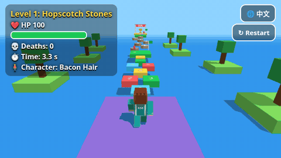

# 🍭☁️ Candy Cloud Dash

**A free 3D jump & run obstacle course in your browser.** Hop across gumdrop islands, crystal sugar paths, lollipop spinners and donut whirls on your way to the Cake Summit. Works on desktop, iPad and phones.

### [▶ Play now](https://designowpro-debug.github.io/candy-cloud-dash/)

English · [中文說明](#中文說明)

## Features
- 🎮 **5 sweet levels**: Gumdrop Hop → Crystal Sugar Path → Lollipop Spin → Donut Whirl → Cake Summit
- 🧍 **3 blocky characters** with different stats and abilities (double jump, sprint, or hard mode)
- ❤️ **HP system**: spinning bars cost HP instead of knocking you off. Grab floating hearts to heal.
- 🚩 **Checkpoints** in every level (3–4 in the harder ones). Kid-friendly difficulty.
- 💎 **Crystal sugar path**: one panel per row cracks, and safe panels you've found stay revealed
- 🛍 **Skin Shop** (optional): cosmetic outfit packs that change only how you look, never gameplay. You unlock them with a license key.
- 📤 **Share** your clear time from the win screen (native share sheet, or copy the link)
- 🕹 **Portal mode**: no shop and no payment links when the game is embedded on a game portal (see below)
- 📱 **Touch controls**: virtual joystick, Jump/Dash buttons, drag to look. No scrolling or zooming, works in portrait and landscape.
- 🌐 **English / 中文** toggle (remembered; or use `?lang=en` / `?lang=zh`)
- 📦 **One self-contained HTML file** with Three.js bundled in. Works offline.

## Controls
| | Desktop | iPad / phone |
|---|---|---|
| Move | WASD / arrow keys | Joystick (bottom-left) |
| Jump | Space (press again in the air = double jump for Bacon Hair) | **Jump** button |
| Sprint | Hold Shift (Crispy Kara) | Hold **Dash** button (Crispy Kara) |
| Camera | Drag the mouse, scroll to zoom | Drag anywhere on the screen |

## Characters
| | Speed | Jump | Ability |
|---|---|---|---|
| **Noob** | ★☆☆☆☆ | ★☆☆☆☆ | None: hard mode |
| **Bacon Hair** | ★★★☆☆ | ★★★★★ | Double jump |
| **Crispy Kara** | ★★★★★ | ★★★☆☆ | Sprint with a stamina bar |

## Levels
1. **Gumdrop Hop**: numbered candy tiles and stepping stones over a soda sea (beginner)
2. **Crystal Sugar Path**: 12 rows, two crystal panels each, and only one holds. Checkpoint halfway.
3. **Lollipop Spin**: moving platforms, spinning discs, slow rotating bars
4. **Donut Whirl**: spinning discs among floating donuts, plus a three-bar walkway
5. **Cake Summit**: rotating cross bar, more bar walkways, and a giant cake at the goal

## Skin Shop & portal mode
- The shop sells 4 cosmetic packs: Neon, Candy, Galaxy (2 outfits each) and the Supporter Pack (all packs, an exclusive Golden Hero skin with a crown, and a ⭐ badge). Payments go through [Lemon Squeezy](https://www.lemonsqueezy.com/). After buying, players paste the license key from their receipt to unlock. See [SETUP-LEMONSQUEEZY.md](SETUP-LEMONSQUEEZY.md).
- Until checkout links are configured, the packs show **Coming soon**.
- **Portal mode** hides the shop and every payment link. It turns on with `?portal=1`, or automatically when the game runs inside an iframe or on any host other than the official GitHub Pages site (for example itch.io or CrazyGames). `?portal=0` forces it off.

## Tech
- [three.js](https://threejs.org/) r159, inlined into a single `index.html` (~750 KB)
- Custom lightweight physics (AABB and disc platforms, moving and spinning platforms, rotating bars)
- WebAudio synth sound effects, no audio files
- `src/game.html` is the source without three.js. `./build.sh` inlines `three.min.js` (three@0.159.0) into `index.html`. `src/*.js` are the headless Chrome (Playwright) tests and asset scripts.
- Hosted on GitHub Pages.

Run locally: `python3 -m http.server` and visit `http://localhost:8000`.
Debug URL params: `?level=1..5`, `&char=noob|bacon|kara`, `&lang=en|zh`, `&portal=1`.

## Disclaimer
An independent original game. Not affiliated with or endorsed by any other game, brand or platform.

## License
[MIT](LICENSE). Bundled [three.js](https://github.com/mrdoob/three.js) is © three.js authors, also under the MIT license.

---

## 中文說明

**糖果雲衝衝 Candy Cloud Dash**：在糖果雲端上跳躍闖關的 3D 原創小遊戲，打開瀏覽器就能玩，支援電腦、iPad 與手機。

▶️ 線上遊玩：https://designowpro-debug.github.io/candy-cloud-dash/

- **五道關卡**：軟糖跳跳 → 冰糖水晶路 → 棒棒糖轉轉 → 甜甜圈漩渦 → 蛋糕之巔
- **三位角色**：菜鳥（無能力、困難模式）、培根頭（高跳＋二段跳）、小咔啦（跑得快＋衝刺）
- **生命值**：被旋轉橫桿打到 -20（不會被撞飛），生命歸零或掉下去都會回到檢查點並回滿血。檢查點附近的 ❤️ 可 +30。
- **造型商店**：霓虹包、糖果包、銀河包、贊助者包。只改變外觀，不影響遊戲。購買後輸入收據裡的授權碼即可解鎖。
- **分享**：過關畫面可分享你的通關時間
- **入口網站模式**：嵌入 itch.io、CrazyGames 等網站或加上 `?portal=1` 時，會隱藏商店和付款連結
- **操作**：電腦用 WASD／方向鍵移動、空白鍵跳、Shift 衝刺、滑鼠拖曳轉視角。平板用左下搖桿、「跳」「衝」按鈕、拖曳畫面轉視角。
- **語言**：右上角 🌐 可切換 English／中文（預設英文，會記住選擇）

獨立原創遊戲，與任何其他遊戲、品牌或平台無關。
